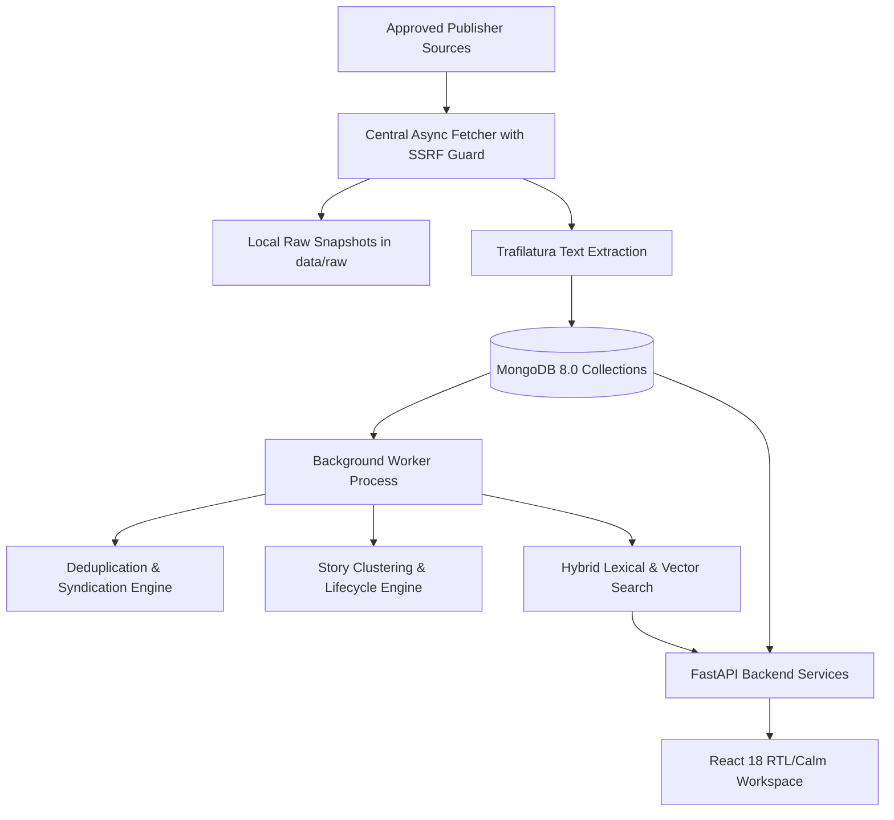

# 🚀 InsightBot 2.0 — Production News Intelligence Platform


> **Enterprise-grade, self-hosted multilingual news intelligence and comparative analysis platform with zero paid API dependencies.**


-61DAFB?logo=react)


---

## 📑 Table of Contents

* [Overview & Architecture](#overview--architecture)
* [Key Features & Capabilities](#key-features--capabilities)
* [Documentation & Specifications](#documentation--specifications)
* [Quick Start (Local & Containers)](#quick-start)
* [CLI Administration Guide](#cli-administration-guide)
* [Testing & Quality Assurance](#testing--quality-assurance)
* [License](#license)

---

## 💡 Overview & Architecture

InsightBot collects, extracts, deduplicates, clusters, compares, and synthesizes news coverage across **Arabic**, **English**, and **Russian** news sources. Engineered as a modular Python monolith with a modern RTL-first React workspace, it runs 100% locally with zero external inference API costs or credit limits.



---

## 🌟 Key Features & Capabilities

- **Strict SSRF & Injection Defense:** Transport-level IP inspection on every HTTP redirect hop eliminates SSRF risks; automated sanitization prevents CSV formula injection (CWE-1236) and prompt overrides.
- **Full Text & Attribution Preservation:** Trafilatura extraction preserves exact quotations, punctuation, and Arabic speaker attribution without lossy normalization.
- **Atomic Worker Leases:** Worker processes acquire monotonic fencing tokens and heartbeat leases in MongoDB, preventing stale commits or split-brain execution.
- **Deterministic ID Derivation:** Canonical URLs yield deterministic SHA-256 stable IDs (`article_id`), preserving historical numeric IDs in metadata.
- **Wire Syndication & Divergence Detection:** MinHash LSH and cosine embeddings identify syndication networks while alerting analysts to conflicting numerical figures (e.g. 12 vs 45 casualties).
- **Dynamic Story Lifecycle:** Clusters articles into stories progressing through `Emerging -> Peak -> Declining -> Closed` with strict 72-hour cutoff and cross-location conflict guards.
- **Hybrid Search Engine:** Combines BM25 lexical ranking with 384-dimensional dense vector embeddings using Reciprocal Rank Fusion ($k=60$) with zero-downtime alias swaps.
- **Multi-Source Event Comparison:** Chronological event timeline, publisher perspective columns, and attributed claim divergence tables.
- **Local Evidence-Backed Synthesis:** Self-hosted briefing generation with passage budgets ($\le 6$ passages), calibrated abstention, and verified exact-quote citations.
- **Disaster Recovery & Retention:** Consistent JSONL backups with SHA-256 cryptographic verification, separate-target restore drill (RTO < 2s), and source-specific retention pruning.

---

## 📚 Documentation & Specifications

| Document | Purpose |
|---|---|
| [**PRODUCT.md**](./PRODUCT.md) | Vision, target personas, functional requirements, and Defect Mitigation Matrix (A01–A20) |
| [**DESIGN.md**](./DESIGN.md) | Calm Design tokens, Arabic-first typography, surface hierarchy, and UI component anatomy |
| [**UX-CONTRACT.md**](./UX-CONTRACT.md) | Interaction states, URL parameter bidirectional sync, screen contracts, and error boundaries |
| [**docs/plan.md**](./docs/plan.md) | Architectural master plan and complete task implementation ledger (Tasks T01–T25) |
| [**docs/release_checklist.md**](./docs/release_checklist.md) | Comprehensive release gate verification matrix and evidence records |
| [**docs/runbooks/operations_runbook.md**](./docs/runbooks/operations_runbook.md) | Second-operator walkthrough, container deployment, and incident response playbooks |
| [**docs/adr/0001_crawler_and_infrastructure_performance.md**](./docs/adr/0001_crawler_and_infrastructure_performance.md) | Architectural decision record evaluating crawler frameworks and performance thresholds |

---

## ⚙ Quick Start

### 1. Prerequisites
- Python 3.12+ and `uv` package manager
- Node.js 20+ (for web development)
- Docker / Podman with Compose support

### 2. Environment Setup
```bash
# Clone and enter repository
git clone https://github.com/dataminds0/InsightBot.git
cd InsightBot

# Create virtual environment and install frozen dependencies
uv sync

# Run database & orchestrator containers
docker compose -f infra/compose.prod.yaml up -d mongo prefect
```

### 3. Initialize Database & Admin
```bash
# Execute idempotent schema migrations
uv run insightbot db migrate --apply

# Interactively provision first administrator account (Zero hardcoded seeds)
uv run insightbot admin create --username "lead_admin"
```

### 4. Start Application
```bash
# Start FastAPI backend and static React SPA server
uv run uvicorn insightbot.api.main:app --host 0.0.0.0 --port 8000 --reload
```
Open in browser: [http://localhost:8000](http://localhost:8000)

---

## 🛠 CLI Administration Guide

InsightBot provides a comprehensive CLI for operators and analysts:

```bash
# System hardware profiling and memory benchmark (Defect A12)
uv run insightbot benchmark run --samples 10 --concurrency 2

# Automated security audit (SSRF, CSV Injection, Prompt Injection, Seed Absence)
uv run insightbot security audit

# Validate approved sources registry and sync to database
uv run insightbot sources validate --sync

# Manage reversible source expansion batches
uv run insightbot sources batch list
uv run insightbot sources batch activate "batch_id" --user "admin"
uv run insightbot sources batch rollback "batch_id" --reason "Rate limited" --user "admin"

# Create consistent backup and execute separate-target restore drill
uv run insightbot backup create
uv run insightbot backup restore-drill data/backups/<backup_id>

# Historical legacy CSV dataset inventory and safe migration
uv run insightbot db inventory --csv-path data/raw/data.csv
uv run insightbot db migrate-legacy --csv-path data/raw/data.csv --dry-run
uv run insightbot db migrate-legacy --csv-path data/raw/data.csv
```

---

## 🧪 Testing & Quality Assurance

InsightBot maintains a comprehensive automated testing suite:

```bash
# Run backend test suite (167 tests)
uv run pytest -q

# Run static typing and linting
uv run mypy src/insightbot
uv run ruff check .

# Run web frontend typecheck and tests (11 tests)
npm run typecheck --prefix apps/web
npm test --prefix apps/web
```

---

## 📜 License

This project is licensed under the [MIT License](./LICENSE).
