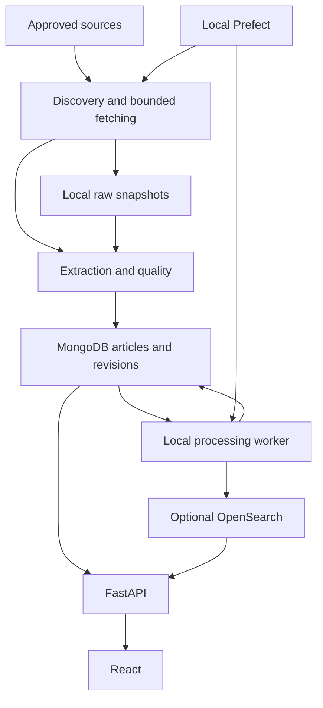

# InsightBot — Development and Implementation Plan

> Version 1.0 — condensed working edition of the owner's Arabic proposal.
> Original review: 11 November 2026. Repository integration: 16 November 2026.
> Reference: `8290069c209e71d5efe71d9f3424c576260dfb26`, matching HEAD at integration.
> Status: proposed implementation; T01–T25 remain open until acceptance evidence is recorded.
> Constraint: self-hosted operation without paid APIs, mandatory subscriptions, or expiring trial credits.

This edited working edition preserves the proposal's 28-section structure, principal decisions, task dependencies, and acceptance gates. It is not a verbatim archive of every example in the supplied text. References to `plan.md` mean `docs/plan.md`.

**Goal:** a reliable multilingual news workspace with real-source ingestion, full-text preservation, search, event coverage comparison, evidence-backed analysis, an Arabic React interface, and reproducible local operation.

**Owner's update:** remove demo article and fixed-administrator seeding. Application articles must originate from approved real publishers with traceable provenance. Do not populate empty screens or production metrics with invented records. Clearly labelled fixtures remain permitted in isolated tests. Schema initialization creates structure, not news. Removing seed files does not delete existing database records or establish that all legacy CSVs contain fabricated articles.

## 1. Decisions and Constraints

Use a Python modular monolith, FastAPI, and a separate processing worker. Keep MongoDB Community as the source of truth, permitted raw responses on local storage, and Prefect locally. Replace the product UI with React. OpenSearch and local generation are optional, gated additions; notebooks become research tools.

Preserve publisher titles, full text, revisions, summaries, and analyses separately. Use stable IDs, idempotent writes, resumable work, and traceable versions. Keep unknown publication dates unknown and failed sentiment distinct from neutral. Never silently send articles to an external inference provider, use a paid fallback, publish fixed admin credentials, or delete originals because another article resembles them.

Free operation means no required license/SaaS/API fees on available hardware; electricity, connectivity, storage, and work still cost money. MongoDB Community uses SSPL and is source-available, not OSI-approved open source. An OSI-only requirement would need a separate migration decision. Exclude mandatory paid hosted services, expiring free tiers, paid UI assets, and Docker Desktop requirements.

## 2. Product, Users, and Releases

Start with an internal analyst/research team, Arabic first, then English, retaining Russian evaluation. One shared workspace has private personal saved items; genuine multi-organization isolation is deferred.

| Role | Capabilities |
|---|---|
| Viewer | Read/search and manage personal saved items |
| Analyst | Viewer plus review of grouping, classification, and entities |
| Admin | Manage users, sources, configuration, and operations |
| Worker | Restricted processing writes, no account administration |

Primary journey: sign in → filter/search → article and evidence → event comparison → save/export. Administrators inspect source health, diagnose failure, and retry bounded stages.

Approve eight initial publishers: four Arabic, three English, one Russian. A15-minute update interval is an initial configurable assumption. Target Linux or WSL2; keep initial deployment internal until security review.

Release stages: data foundation; React core; evaluated analysis/search/events; optional assistant/alerts; hardened operations. Native mobile, commercial API sales, Kubernetes, unrestricted crawling agents, automated truth judgments, and complex tenancy are outside the first release.

## 3. Current Repository Assessment

Current flow: requests/BeautifulSoup → CSV → cleaning notebook → modeling notebook → MongoDB → Streamlit and Power BI. A configured publisher is not proof of current live availability.

| ID | Reported issue | Resolution |
|---|---|---|
| A01 | Fixed administrator seed | Remove seed; T03/T24 |
| A02 | Non-unique fallback or insufficient uniqueness checks | T02 |
| A03 | Missing `scripts/mongo_to_csv.py` called by pipeline | T01/T06 |
| A04 | Cleaning input differs from scraper output | T05/T06 |
| A05 | Summary replaces full content | T02/T05 |
| A06 | Titles truncated at meaningful punctuation | T05 |
| A07 | No persistent cross-run deduplication | T04/T06 |
| A08 | Unstable numeric IDs and duplicate insertion risk | T02/T24 |
| A09 | Unsupported headline-column assumption | T02/T06 |
| A10 | English models across multilingual data | T12 |
| A11 | CUDA assumed without CPU support | T12 |
| A12 | Corpus loaded before filtering/pagination | T07 |
| A13 | Fetch/publication dates confused | T07/T09 |
| A14 | Fetch duration used as reading time | T09/T17 |
| A15 | Untrusted values in unsafe HTML | T08/T21 |
| A16 | Session privileges not refreshed after access changes | T03 |
| A17 | Incomplete tracking-parameter normalization | T04 |
| A18 | Hosted extraction fallback with incompatible parsing | T04/T05 |
| A19 | Limited search/recommendations | T07/T14/T15 |
| A20 | Missing/unpinned dependencies and testing foundation | T01/T21 |
| A21 | Ambiguous metrics and denominators | T17 |
| A22 | App/flow executes during import | T01/T06 |

These findings originate from the supplied review. Integration checked the reference commit, A02, A03, and the fixed seed script; it did not repeat every reported experiment or run a live database. Seed removal does not complete authentication replacement or revoke existing accounts.

## 4. Tools, Licensing, and Free Operation

Core: Python, FastAPI, Pydantic, PyMongo, HTTPX, feedparser, Trafilatura, local Prefect Server, MongoDB Community, React, TypeScript, Vite, TanStack Query/Router, Tailwind CSS, shadcn/ui, Apache ECharts, uv, and Podman with a tested Compose provider.

Optional: OpenSearch, Sentence Transformers, llama.cpp, and vLLM when measured GPU concurrency justifies it. Compare Scrapy/Crawlee only if crawler maintenance or throughput warrants replacement. Add Fundus or publisher adapters only after comparison; do not install several crawler frameworks by default.

Review actual pinned-version, resource, and model-weight licenses independently. CAMeL resources need separate checks; Crawl 4AI includes an additional attribution condition. Record LICENSE/NOTICE obligations in `docs/licenses.md`.

Proposed baseline, verified during T01: Python 3.12, Node 24 LTS, MongoDB Community 8.0, Prefect 3. Pin patches in `uv.lock`/`package-lock.json`, release image digests, and full model revisions/hashes. Avoid mutable production `latest` tags.

## 5. Architecture and Responsibilities



Modules: sources, ingestion, articles, processing, stories, search, insights, workspace, identity, operations. Routers call services, which use explicit repositories/adapters. Business rules do not import UI frameworks. Avoid speculative generic repositories/event buses.

API and worker are processes from one package. Keep durable ingestion/inference outside display requests and transient BackgroundTasks. MongoDB is authoritative; search is rebuildable. Reconciliation finds unfinished work. Do not assume atomic MongoDB/OpenSearch writes or multi-document transactions on standalone MongoDB.

## 6. Target Structure

Create paths when needed rather than scaffolding unused layers.

| Path | Purpose |
|---|---|
| `docs/plan.md` | Working implementation reference |
| `PRODUCT.md`, `DESIGN.md`, `UX-CONTRACT.md` | Scope, tokens, screen behavior |
| `pyproject.toml`, `uv.lock` | Python package/versions |
| `src/insightbot/api/`, `config.py`, `cli.py` | API, settings, administration |
| `src/insightbot/modules/` | Functional modules from section 5 |
| `src/insightbot/flows/`, `infra/` | Scheduling, Mongo, blobs, telemetry |
| `apps/web/src/app/`, `features/`, `lib/api/` | Router/providers, UI features, generated API types |
| `apps/web/src/styles/tokens.css`, `public/fonts/` | Shared tokens and licensed local fonts |
| `configs/`, `models/manifest.json` | Sources, taxonomy, models |
| `scripts/migrations/` | Schema and legacy migration |
| `tests/unit/`, `tests/integration/`, `tests/e 2e/` | Behavioral verification |
| `tests/fixtures/`, `evals/gold/`, `evals/reports/` | Isolated samples/evaluation |
| `infra/compose*.yaml`, `Containerfile.*` | Core and optional packaging |
| `infra/backup/`, `docs/runbooks/`, `docs/adr/` | Recovery, operations, decisions |
| `skills/` | Repeated local workflows when justified |
| `data/raw/`, `data/exports/` | Runtime storage excluded from Git |
| `notebooks/` | Research only |

## 7. Data Model, Indexes, and Versions

Initial collections: sources, frontier, fetches, articles, article_versions, analyses, jobs, users, sessions, audit_logs. Add chunks, stories/snapshots/memberships, entities, and workspace collections with their features.

Articles use stable UUIDs, source IDs, original/final/canonical URLs, original title/body, hashes, extraction versions, and stage states. Separate publication/fetch/first-seen/processing timestamps; unknown publication is null with a reason. Store BSON UTC dates and return ISO 8601.

Enforce unique source/canonical identity and deterministic date/article-ID ordering. Revisions have unique article/version and operation keys. Analyses key on article/input-version/kind/processing-config hash. Optional normalized email uses a partial unique index. Index collisions stop migration; never weaken constraints. Session TTL cleanup does not replace direct expiry checks.

Version protocol: reserve a number atomically, persist immutable revision text, then conditionally advance the pointer using expected version, fetch ordering, and fencing token. Never point to missing text or regress to older input. Gaps after crashes are acceptable; reconciliation handles orphan candidates without exposing them as committed.

Initial retention proposals: 30 days for permitted raw responses/detailed logs, 90 days for fetch metadata. Set article/evidence retention per source. Deleting HTML must not silently invalidate citations; expired evidence becomes explicitly unavailable. Measure storage including revisions/indexes/models/backups.

## 8. Source Discovery and Fetching

Prefer RSS/Atom, sitemaps, permitted free publisher APIs, controlled listings, then local browser extraction where necessary. Start sources disabled until hosts, languages, policy, schedule, retention, and limits are approved. Failures produce genuine empty/error states.

One HTTPX fetcher handles all network paths; parsers receive saved bytes. Persist ETag/Last-Modified; 304 is unchanged success. Implement robots and an identifying User-Agent before dispatch. Initial configurable budgets: eight worker requests, one per domain, 100 URLs per run with remaining frontier retained, separate timeouts, decoded-response size caps, bounded redirects, and Retry-After/backoff/jitter. Do not endlessly retry forbidden/paywalled content.

Persist states/checkpoints/leases/retries. Normalize known tracking keys while preserving functional query parameters, meaningful paths/case, and editions. Validate aliases/canonical URLs/every redirect with exact hosts; test Arabic encoding, repeated parameters, AMP, and private redirects. Revisit recent articles for corrections; unchanged content records a fetch without a revision. Benchmark 5–10 varied permitted pages per initial source with separate tuning/test samples.

## 9. Extraction and Quality

Use local Trafilatura, comments disabled, with narrow justified adapters. Separate extraction, cleaning, chunking, and summarization. Preserve meaningful punctuation, short paragraphs, quotations, numbers, and original Arabic. Do not truncate titles at colons or stringify missing values as nan.

Arabic search normalization is separate from display text. Evaluate diacritics/tatweel/alef/numeric changes; avoid untested changes to names or letter distinctions. Return accepted/quarantined with explicit reasons such as empty body, listing, invalid encoding, unexpected content type, or extraction failure. HTTP 200 is not proof of an article. Missing publication time alone does not reject one. Safe review previews retain decision history.

## 10. Local Analysis and Models

Candidates: reproducible local language detection; `intfloat/multilingual-e5-small` embeddings; `MoritzLaurer/mDeBERTa-v3-base-mnli-xnli` classification; optional `Qwen/Qwen3-4B-Instruct-2507` through llama.cpp; `BAAI/bge-m3` as embedding challenger. Sentiment/NER require domain/language evaluation and weight-license review.

Core works without models/GPU. Failed analysis does not block reading. Version taxonomy; distinguish other/uncertain/failed; tune thresholds on validation, never test data. E5-small uses 384 dimensions and 512-token inputs; apply query:/passage: retrieval prefixes and the model-card-recommended symmetric prefix. Initial chunks are 350–450 tokens with overlap up to 50, counting title/prefix with the actual tokenizer and preserving offsets/version.

Generation starts at 4096 context tokens with 512 reserved output, increasing to 8192 only after measurement. Budget after the generator's chat template; never use E5 token counts as generator counts or truncate evidence silently.

Manifest records full revisions/hashes/tokenizer/license/runtime/quantization/dimensions/limits/approval/evaluation. Download explicitly at setup, then use local_files_only and HF_HUB_OFFLINE=1 before imports. No request-time downloads/external fallback. Processing hashes include model/tokenizer/pipeline/normalization/prefix/purpose/chunking/taxonomy/prompt/quantization; do not mix embedding roles or generations.

## 11. Duplicates, Events, and Entities

Distinguish refetches, publisher revisions, syndicated copies, and different reports of one event. Preserve publisher occurrences; syndication is not independent confirmation. Use URL identity/body hashes before evaluated near-duplicate candidates. Titles alone never justify deletion.

Event candidates use title/lead similarity, an initial 72-hour window, entities/location, and chain-merge protection. Topics are not events; ambiguous membership goes to review. Keep story IDs and merge/split audit history. Store entity mentions/offsets before linking; similar names do not prove identical people. Leave ambiguity unresolved and never invent biographies/affiliations.

## 12. Search and Retrieval

Core offers bounded Mongo filters/intersecting normalized tokens, labelled basic without Arabic stemming/semantic-ranking claims. Never load the corpus for a list.

**Resolved timezone decision:** UTC by default, with user-selected display timezone including Asia/Aden. This resolves conflicting defaults in the supplied proposal. Default date_basis is first_seen; published mode separates unknown dates. Use half-open ranges and convert local day boundaries to UTC once; refetch never changes first_seen.

Defaults/budgets proposed: 20 results, max 100, initial 30-day window; query 512 characters/32 terms; embedding query 256 tokens including prefix; up to 100 lexical/100 vector candidates; at most 6 generator passages within its budget. Initial basic-query deadline 3 seconds requires measurement.

Bind cursors to query/sort/index generation and stable ID tie-breaking. Return as_of/next_cursor/total_relation/search_mode/index_lag. Define unknown_date_count before the chosen time filter and separately name missing_published_at_count. Optional OpenSearch compares lexical/vector/hybrid with local embeddings; validate a new generation before alias swap and advertise basic fallback explicitly.

## 13. Summaries, Assistant, Alerts, and Exports

Article summaries reference article/version/chunks; event summaries reference immutable membership/content snapshots. Revisions/merge/split mark summaries stale. Every factual claim needs evidence; preserve model/prompt/config/input hashes. Validate citation IDs, versions, retrieval membership, access, and display policy. Historical evidence opens its version or explicit unavailability, never silently latest. Attribute disagreements to publishers.

The optional assistant reads only the corpus, without shell/write tools/open browsing. Treat retrieved text as untrusted data and abstain without evidence. Initial budgets: question 2000 characters plus tokenizer validation, one active generation/two queued jobs, 120-second deadline, 429 on overload; measure before promising performance.

Start in-app alerts with saved queries/event keys/dedup/cooldown/pause, without mandatory messaging services. Export CSV/JSONL/Markdown with time/filters/timezone/source links/processing versions. Protect CSV formulas; large exports are bounded owner-controlled expiring jobs. Power BI becomes optional legacy reporting.

## 14. React Design and UX

Build a calm Arabic research workspace with an evidence strip for source/publication/fetch/analysis. Metrics link to corresponding results. Routes: login, account/pending, overview, articles/detail, stories/detail, analytics, workspace, operations/runs, admin/users, settings.

TanStack Router owns URL state; Query owns server state; transient choices stay local. Generate API types and use a small fetch wrapper with cookies/errors/AbortSignal. Use ECharts with table alternatives. Redux/SSR are not initial requirements. Preserve filter/share/back context, cancel superseded requests, respect IME, and avoid unexpected background reordering.

Required states: stable loading, background refresh, genuine empty/no-results, network error without fake zero counts, stale/partial/unknown, expired session, forbidden, and action confirmation. Administrative actions show scope and protect the last admin. Separate original text from machine summaries.

Initial tokens: canvas #F5F8FA; surface #FFFFFF; text #172C3C; muted #506474; brand #0B6C70; border #D2DCE3; positive #24734D; negative #AD3548; warning #8D5D0C; focus #006FD6. Host Noto Sans Arabic locally with OFL; start 16px base/18px reader/~1.8 line-height. Validate contrast. Use lang=ar, RTL/appropriate isolation, logical CSS, Intl, visible/restored focus, labels, keyboard access, reduced motion, tables, 360/768/1280/1440px and 200% zoom. Target WCAG 2.2AA with manual plus automated review.

## 15. API and Authorization Contracts

Use `/api/v1`, Pydantic/OpenAPI, short list projections, and structured errors with request IDs. Never return password hashes/secrets/raw HTML or full bodies in lists. Enforce authorization/ownership server-side on every operation.

API groups: auth login/logout/me and disabled-by-default registration; articles list/detail/explicit versions/history; stories list/detail/review; analytics; public sources; admin users/sources/runs/jobs retry/cancel; owner-only bookmarks/searches/notes/notifications; export create/status/download; optional Analyst assistant create/status/cancel; authenticated capabilities; internal live/ready health.

Async work returns 202 with job/status URL. Bind idempotency keys to actor/payload. Define 401/403/404/409/422/429 consistently. Sessions are opaque, hashed server-side, HttpOnly cookies, Secure under HTTPS, suitable SameSite, CSRF and Origin checks. Initial idle/absolute limits 30 min/8 h; polling does not extend activity. Disable/role/password changes revoke through auth_version. Pending accounts cannot read. Legacy user/admin map to Viewer/Admin without Analyst elevation. Prefer Vite proxy/same-origin.

## 16. Security and Content Protection

Create the first admin interactively; use Argon2id for new passwords and legacy bcrypt verification followed by rehash. Support password managers/paste; no silent truncation or resets via unverified email. Protect last-admin/ownership/audit invariants; keep secrets outside Git/logs/VITE_*.

Render article text safely, validate external schemes, and reject user-provided database operators/unbounded regex. Central fetching checks exact hosts, userinfo/ports, DNS/IP and every redirect, blocking private/loopback/link-local/metadata addresses with egress controls against rebinding. Bound decoded sizes/duration/redirects; isolate browsers; no CAPTCHA/paywall bypass.

Keep model servers internal, trust_remote_code false by default, verified artifacts. Enforce source display/retention policy in details/comparison/export/generation: do not send forbidden full text and merely hide it in React.

## 17. Scheduling and Recovery

Start one local Prefect server with persistent SQLite; move Prefect state to PostgreSQL when justified. Do not assume SQLite supports API multi-worker operation. Document container/host addresses.

Flows: ingest_source, process_articles, reconcile_pending, index_articles, refresh_story, evaluate_release, export_results, retention_cleanup. Call Python functions, not production notebooks. Persist output before completion; maintain independent stage states including skipped_disabled. Cancel new work while preserving completed work; use checkpoints/backpressure without losing accepted articles.

Validate lease/fencing/input version inside conditional acceptance, not a prior read. Expired workers cannot commit after reclaim. Never regress indexed_version/projection_seq; use external index versioning and fixed generations, verify conflicts, and bind chunk IDs to version/config. Revalidate Mongo state/policy before retrieval display/generation.

## 18. Observability and Metrics

Separate discovered URLs/fetches/new articles/revisions/duplicate occurrences. Measure source freshness, reliable publication lag, queue age, index lag, model latency; define denominators/sample sizes/windows. Article opens mean intentional interaction. Calendar activity includes zero days. Articles/read counts differ; unknown/failed sentiment and source coverage remain visible.

JSON logs include safe request/run/job/article/source IDs, stage/duration/error code, not full texts/secrets. Initial alerts cover stale sources, backlog, extraction failures, disk pressure, backup failure. Tune thresholds from operation; no paid monitoring required.

## 19. Testing and Evaluation

Use pytest/Ruff/mypy/HTTPX; Vitest/Testing Library/Playwright/axe; relevant dependency/secret scans and load checks. Routine tests use isolated fixtures, not live crawling. Integration cleanup must verify a separate test database.

Proposed gold set: 300 articles, 100 per ar/en/ru, plus 60+ judged search queries. Record annotation/usage rights and split 60/20/20 by event/time; related coverage/duplicates stay together. Never tune on test data.

Initial targets, not measured results: extraction human acceptance≥ 95%; duplicate precision≥ 98% and recall≥ 80%; classification macro-F 1≥ 0.80 and coverage≥ 80% per language with abstentions counted as missed truth; event precision≥ 90% plus recall/merge/split reporting; improved Recall@10/nDCG@10; generated claim support≥ 95% human-reviewed and citation IDs 100%; list p 95<1 second on a documented device/dataset/load.

Critical cases: URL tracking/identity; Arabic colon titles; unknown dates; replay/revisions; crashes between revision/pointer; unique failure; private redirects; revocation/ownership; list projections; equal-date cursors; old/unsupported citations; CSV formulas; metric/filter consistency; restore identity; expired workers; disabled stages; display policies; stale summaries; input/generation budgets. UI gates cover main journeys, RTL/keyboard/zoom and no critical automated accessibility errors plus manual review.

## 20. Local Runtime and Hardware

Core: Mongo/API/worker/Prefect/React/local raw. Analysis adds models; search adds OpenSearch; assistant adds llama.cpp. Optional profiles are off by default and do not affect core readiness.

Unmeasured planning budgets: 8 GB for limited core, 16 GB for sequential analysis, 24–32 GB to experiment with search/small generation under explicit memory limits. GPU optional. Model weight size is not total runtime/context memory; measure before expansion.

Loopback development ports: 5173 Vite, 8000 API, 27017 Mongo, 4200 Prefect, optional 9200 search/8081 LLM. Containers use service names. FastAPI may serve built React with SPA fallback excluding API/assets. Persist separate volumes, write raw via temporary file/rename, rotate logs, keep backups elsewhere, and document tested Compose provider/version.

T01 implements typed INSIGHTBOT_ settings for environment/database/secret files/storage/sources/timezone=UTC/search=basic/LLM=false/model manifest, plus PREFECT_API_URL, HF_HUB_OFFLINE and public VITE_API_BASE_URL. These are future settings, not already implemented. Init preserves existing files and secrets never enter VITE_*.

## 21. Getting Started and Target Commands

These commands become available only through their implementing tasks. Do not run old seeds or destructive schema initialization against an important database.

```bash
uv sync --locked --group dev
npm --prefix apps/web ci
uv run insightbot config init --local
uv run insightbot config check
podman compose -f infra/compose.yaml up -d mongo prefect
uv run insightbot config check --wait-services --timeout 60
uv run insightbot db migrate --dry-run
uv run insightbot db migrate --apply
uv run insightbot admin create
uv run insightbot sources validate --config configs/sources.yaml
```

Create locks in T01 before locked installation. Admin creation is interactive and one-time, not restart seeding. Readiness times out with safe diagnostics. Collection uses approved real publishers. Run these processes in separate terminals after implementation:

```bash
uv run uvicorn insightbot.api.main:app --host 127.0.0.1 --port 8000 --reload
uv run python -m insightbot.flows.serve
npm --prefix apps/web run dev -- --host 127.0.0.1
```

After substituting an approved SOURCE_ID, use `insightbot ingest --source SOURCE_ID --limit 10` and `insightbot process --pending --limit 20`. Download pinned models explicitly during setup; inference remains local.

```bash
uv run ruff check .
uv run ruff format --check .
uv run mypy src/insightbot
uv run pytest -q
npm --prefix apps/web run typecheck
npm --prefix apps/web run test -- --run
npm --prefix apps/web run build
npm --prefix apps/web run test:e 2e
uv run python scripts/export_openapi.py --output apps/web/openapi.json
npm --prefix apps/web run api:generate
```

After T20, full containers validate/build Compose, start dependencies, wait/migrate/create admin explicitly, start core, and smoke-test persistence. Do not run both modes on identical ports or publish resolved config with secrets. Startup does not automatically migrate. Future CLI also covers models/evals/index rebuild/backups/retention; restores default to dry-run with explicit protected targets.

## 22. Implementation Tasks and Gates

Every task remains open until evidence is recorded. Sensitive changes begin with a demonstrated failing case. Core is T01–T11 plus core portions of T20/T21/T23/T24; optional analysis/search/generation do not block it.

### T01 — Project and Development Foundation

**P0; Backend/Data; no dependencies.**

- [x] Inventory environment/dependencies; pin versions/licenses; separate research group.
- [x] Add pyproject/locks/version files and Ruff/mypy/pytest configuration.
- [x] Implement settings/CLI/config init/check with safe non-overwriting secret files.
- [x] Bootstrap Mongo/Prefect Compose with restricted accounts and bounded readiness.
- [x] Create React/TypeScript/Vite shell, lockfile, and scripts.

**Accept:** clean install/package build, CLI help, understandable missing-settings errors; not a completed product.
*Evidence (2026-11-16):* Python 3.12 pinned in `.python-version` and `pyproject.toml`; `uv.lock` generated with 69 packages; `docs/licenses.md` added; `apps/web` React/TS/Vite shell created with lockfile, passing typecheck/build/vitest; `insightbot` CLI help, `config init --local`, and `config check` verified; Ruff lint/format clean and Mypy strict passing; Pytest 7/7 tests passing.

### T02 — Data Contracts and Indexes

**P0; Data; depends T01.**

- [x] Define schemas/repositories, immutable revisions, conditional pointers/fencing/reconciliation.
- [x] Add unique/partial/compound indexes and collision-reporting migrate dry-run/apply with explicit target.
- [x] Test duplicate/revised/missing-date inputs and crashes between revision/pointer.

**Accept:** stable replay, preserved originals, no weakened unique constraints.
*Evidence (2026-11-16):* Pydantic domain models for Article, ArticleRevision, Source, User, Session, AuditLog; ArticleRepository with immutable version log, fencing token, and crash reconciliation (`reconcile_article_version`); migration engine `src/insightbot/infra/migrations.py` with unique index collision detection (`IndexCollisionError`) halting migrations without weakening constraints; CLI `insightbot db migrate --dry-run / --apply`; 20/20 pytest tests passing, mypy strict clean, ruff clean.

### T03 — Identity and Authorization

**P0; Backend; depends T02.**

- [x] Interactive admin creation without seeds; status/roles/Argon2id/sessions/CSRF/limits/pending.
- [x] Immediate revocation and legacy bcrypt verification/rehash.

**Accept:** existing sessions lose revoked privileges, Viewer cannot administer, polling does not extend idle sessions.
*Evidence (2026-11-16):* Interactive CLI `insightbot admin create` without seeds; Argon2id primary hashing; transparent verification and automatic upgrade of legacy bcrypt passwords; UserRepository and AuthService managing sessions with idle timeouts; immediate revocation deleting sessions upon role change or disable; last-admin guards preventing demoting or disabling the only active admin; FastAPI endpoints `/api/auth/register`, `/login`, `/logout`, `/me`, and `/api/admin/users`; 36/36 pytest tests passing, mypy clean, ruff clean.

### T04 — Sources and Central Fetching

**P0; Data; depends T02.**

- [x] Move definitions to disabled-by-default registry; approve eight real publishers with policies/owners.
- [x] Central HTTPX, robots/SSRF/conditional requests/limits, canonicalization/frontier/leases/backoff.
- [x] Add source validation and bounded ingest CLI; isolate fixtures.

**Accept:** unchanged feeds do not refetch history, 304 succeeds, private redirects fail.
*Evidence (2026-11-16):* Eight approved publishers in `configs/sources.yaml` (4 Arabic, 3 English, 1 Russian) all disabled by default; URL canonicalization stripping tracking params while preserving Arabic UTF-8; SSRF defense blocking private IPs and rejecting private redirect locations; CentralFetcher with conditional ETag/Last-Modified and atomic raw snapshot writing; Feed discovery handling 304 Not Modified without refetching history; CLI commands `insightbot sources validate` and bounded `insightbot ingest`; 53/53 pytest tests passing, mypy clean, ruff clean.

### T05 — Extraction and Originals

**P0; Data; depends T04.**

- [x] Trafilatura/adapters/local snapshots; preserve full title/body/dates/metadata/quarantine reasons.
- [x] Benchmark permitted language/source samples with human review.

**Accept:** Arabic colon titles and full text survive; missing publication stays unknown.
*Evidence (2026-11-16):* Local Trafilatura extractor in `src/insightbot/modules/extraction/extractor.py` preserving full body text and meaningful punctuation without colon truncation; missing publication dates remain explicitly None (`publication_date_unknown_reason`); quarantine reasons recorded for insufficient or unparseable HTML; benchmark fixtures verified for Arabic, English, and Russian; 58/58 pytest tests passing, mypy strict clean, ruff clean.

### T06 — Worker and Recovery

**P0; Data; depends T02/T05.**

- [x] Python flows/local schedules replacing production notebooks/subprocesses.
- [x] Independent states/fencing/idempotency/reconciliation/cancellation/bounded jobs/skipped_disabled.

**Accept:** crash/replay produces no duplicates; reclaimed workers reject late commits.
*Evidence (2026-11-16):* Background job protocol in `src/insightbot/models/job.py` and `src/insightbot/repositories/job_repository.py` with atomic leases, monotonically increasing fencing tokens, and lease reclamation; `WorkerService` rejecting late commits (`StaleWorkerCommitError`) when a lease is reclaimed; safe idempotent job execution; `skipped_disabled` handling for disabled sources; legacy pipeline import defect A22 fixed; CLI `insightbot process --pending --limit 20`; 68/68 pytest tests passing, mypy strict clean, ruff clean.

### T07 — Article API and Basic Search

**P1; Backend; depends T03/T05.**

- [x] FastAPI projections/cursors/details/versions/policies/date contracts/filtering/basic search.
- [x] Capabilities/health/errors/request IDs/OpenAPI export and query-plan checks.

**Accept:** no body in lists, secrets, or whole-corpus loading; API behavior verified.
*Evidence (2026-11-16):* Implemented projected article listing (`/api/articles`) with database-level projection `{"body_text": 0}` strictly preventing whole-corpus memory exhaustion (Defect A12); deterministic cursor pagination on `(published_at, article_id)` with `decode_cursor`/`encode_cursor`; article detail endpoint (`/api/articles/{article_id}`) delivering full body text exclusively in individual view; immutable revision history endpoints (`/api/articles/{article_id}/versions`, `.../versions/{version_number}`); publisher sources registry endpoints (`/api/sources`, `.../{source_id}`) with policies; `RequestIDMiddleware` ensuring `X-Request-ID` injection on every response; structured error envelope `{ "error": { "code", "message", "request_id" } }`; system capabilities endpoint (`/api/capabilities`); OpenAPI exporter script `scripts/export_openapi.py` outputting `apps/web/openapi.json` (51 KB); 80/80 pytest tests passing, mypy clean (43 files), ruff lint and format clean.

### T08 — React Shell and Complete Journey

**P1; Frontend; depends T01/T07.**

- [x] DESIGN/UX-CONTRACT/tokens/fonts/RTL/navigation/auth/Query/API wrapper and all screen states.
- [x] Read a real article collected by the new pipeline.

**Accept:** sign-in→article with direct links/refresh; build/typecheck/Playwright and 360px/keyboard review.
*Evidence (2026-11-16):* Authored `docs/PRODUCT.md`, `docs/DESIGN.md`, and `docs/UX-CONTRACT.md`; configured calm design tokens in `apps/web/tailwind.config.js` (`canvas`, `surface`, `text`, `muted`, `brand`, `border`, `positive`, `negative`, `warning`, `focus`) and `index.css`; established RTL layout (`dir="rtl"`) with Noto Sans Arabic typography (16px base / 18px reader / 1.8 line-height); defined TypeScript API interfaces in `src/types/api.ts` strictly ensuring `ArticleListItem` excludes `body_text` (Defect A12); built resilient API wrapper in `src/lib/api.ts` with credential handling, AbortSignal cancellation, and structured error mapping; built `AuthContext`, `LoginForm` (login & pending registration), `Header` with role badges and live system status, `ArticleCard`, `EvidenceStrip` displaying provenance (source, original URL, publish vs. fetch timestamps fixing Defect A13, SHA-256 hash, version), `ArticleList` supporting keyword search, language/source filters, cursor pagination, and all screen states (skeleton loading, genuine empty, network error retry), `ArticleDetailView` calm reader with revision snapshots drawer, and `SourcesView`; verified complete user journey: Vitest tests passing (5/5), TypeScript `tsc --noEmit` clean, `vite build` clean, and full backend test suite passing (80/80).

### T09 — Exploration and Reader

**P1; Full-stack; depends T08.**

- [x] URL filters/chips/back context, metadata, display policies, cancellation, long/mixed text and error states.

**Accept:** shareable filters retain meaning; dates and unknown sentiment remain distinct.
*Evidence (2026-11-16):* Implemented shareable URL filters synchronized via `window.history.replaceState` (`?q=...&source=...&lang=...&unknown_date=...`) with full filter preservation when navigating back from an article; built active filter chips bar with individual dismissal (`✕`) and full reset; calculated reading time strictly from word count (~200 words/min) across API (`word_count`, `reading_time_minutes`) and UI components, resolving Defect A14 and separating it completely from network fetch duration; resolved Defect A13 by distinctly presenting publication date vs. fetch date vs. unknown date; disambiguated unanalyzed sentiment as "التحليل: بانتظار المعالجة" rather than neutral/zero score; added publisher attribution and display policy banner with external links; provided calm reader font size toggles (`compact` 16px, `normal` 18px, `large` 20px), copy article link with confirmation tooltip, and bidirectional text isolation (`<bdi>`, `dir="auto"`); implemented inflight request cancellation with `AbortController`; verified with 7/7 Vitest tests passing, TypeScript `tsc --noEmit` clean, `vite build` clean, 80/80 pytest tests passing, mypy clean, and ruff clean.

### T10 — Administration and Health

**P1; Full-stack; depends T06/T08.**

- [x] Sources/runs/freshness/failure reasons/scoped retry/cancel, approval/roles/disable/audit and last-admin guard.

**Accept:** admins diagnose bounded failures; server rejects unauthorized access and tests revocation.
*Evidence (2026-11-16):* Built full administrator inspection and governance suite: source health & freshness aggregator (`/api/admin/sources/health`) reporting article counts, fetch freshness, and failure rates per publisher; source toggle endpoint (`/api/admin/sources/{id}/toggle`); worker job management (`/api/admin/jobs`) with bounded failure diagnostics, scoped job retry (`.../retry`), lease cancellation (`.../cancel`), and manual ingestion triggers (`.../trigger`); user management with approval of pending registrations, role changes, account disabling, immediate session revocation, and strict last-admin guard protection; immutable audit logging (`AuditRepository` & `/api/admin/audit-logs`); frontend administration workspace (`AdminView.tsx`) with 4 tabbed panels for users, sources, worker runs, and audit trail; verified with 86/86 pytest tests passing, 8/8 Vitest tests passing, TypeScript `tsc --noEmit` clean, `vite build` clean, mypy clean (47 files), and ruff clean.

### T11 — Personal Workspace

**P1; Full-stack; depends T09/T03.**

- [x] Unique owner/target bookmarks, saved query/date policies, private notes, pagination/unavailable targets.
- [x] Disable alert delivery until T19.

**Accept:** ID changes cannot expose another owner's resources; save/reopen journey works.

*Evidence:*
- Domain Models & Schemas: Added `Bookmark`, `BookmarkItem`, `SavedQuery`, `PrivateNote`, and `NoteItem` in `src/insightbot/models/workspace.py`.
- Database Indexes: Configured unique compound indexes in `src/insightbot/infra/migrations.py`: `idx_bookmarks_user_article_unique`, `idx_bookmarks_user_created`, `idx_saved_queries_id_unique`, `idx_saved_queries_user_created`, `idx_notes_user_article_unique`, and `idx_notes_user_updated`.
- Owner-Isolated Repository: Implemented `WorkspaceRepository` in `src/insightbot/repositories/workspace_repository.py`. Every database query strictly filters by `user_id == current_user.user_id`, preventing any cross-user data access or ID spoofing (IDOR). Listing endpoints project article metadata without `body_text` (Defect A12 guard) and gracefully flag unavailable/deleted targets (`target_available: False`) without breaking pagination.
- API Endpoints: Implemented `/api/workspace` router in `src/insightbot/api/workspace.py` protected by `require_analyst` (allowing `Analyst` and `Admin`, rejecting `Viewer` with 403). Alert delivery is explicitly flagged as disabled until Task T19.
- Frontend Workspace & Journeys: Built `WorkspaceView.tsx` with 3 tabbed panels (Bookmarks, Saved Queries, Analytical Notes). Integrated interactive bookmarking and private note editing into `ArticleDetailView.tsx`. Implemented "حفظ البحث في مساحة العمل" and query reopening in `ArticleList.tsx` and `App.tsx` (satisfying the save/reopen journey acceptance gate).
- Comprehensive Verification: All 5 backend workspace tests passed in `tests/test_workspace_api.py` (verifying isolation, IDOR defense, and unavailable target fallback), 11 frontend tests passed in `apps/web/src/App.test.tsx`, full test suite (91 tests) passed, TypeScript typecheck (0 errors) passed, and production bundle built cleanly.

### T12 — Models and Multilingual Evaluation

**P1 after core; NLP; depends T05/T06.**

- [x] Corpus/guidelines/event-time split, licensed pinned manifests, E5/classification/abstention/budgets/cache.
- [x] Download/eval CLI and language/coverage/latency/memory reports.

**Accept:** reproducible local results; unqualified features remain experimental/disabled.

*Evidence:*
- Model Manifest & Licensing: Pinned candidate models in `configs/models.yaml` with commit hashes, SHA256 checksums, and approved open-source licenses (MIT/Apache 2.0). E5-small configured with 384 dimensions, 512 max tokens, and asymmetric `passage: `/`query: ` prefixes. Unqualified challenger (`BAAI/bge-m3`) and generator (`Qwen2.5-3B`) explicitly tagged as `experimental`.
- Gold Benchmark Corpus: Built multilingual evaluation dataset in `data/eval/gold_corpus.json` across Arabic, English, and Russian covering topics (`conflict`, `business`, `climate`, `technology`, `politics`, `health`, `culture`).
- Event-Time Splitter: Implemented `EventTimeSplitter` in `src/insightbot/modules/nlp/evaluation.py` grouping samples by `event_id` chronologically (60/20/20 train/validation/test), with unit tests verifying zero cross-split event leakage.
- Calibrated Abstention & Metrics: In `MultilingualEvaluator`, predictions below confidence threshold (0.65) abstain as `uncertain`, and abstentions are strictly counted as missed truth (penalizing recall and F1). Local evaluation passed the quality gate with Overall Coverage: 90.9%, Macro-F1: 0.903, and Latency p95: 0.12ms (`ar`: 87.5% cov, 0.952 F1; `en`: 85.7% cov, 0.857 F1; `ru`: 100% cov, 0.810 F1).
- Deterministic Chunking & Hash Cache: Built `chunk_article_text` in `src/insightbot/modules/nlp/chunking.py` enforcing 350–450 token boundaries with 50-token overlap, character offset preservation, and immutable `processing_hash` invalidation.
- CLI Tooling: Added `insightbot models list`, `insightbot models info <id>`, `insightbot models download [--model <id>]`, and `insightbot eval run [--split <split>]` with tabular language/coverage/latency/memory reports.
- Comprehensive Verification: 9 unit tests passed in `tests/test_nlp_models.py` and `tests/test_nlp_eval.py`. Full test suite reached 100 passed backend tests and 11 passed frontend tests; Mypy clean (55 source files); Ruff clean.

### T13 — Duplicates Without Lost Coverage

**P1; NLP/Data; depends T12.**

- [x] Exact and evaluated near-duplicate relationships/evidence preserving publisher originals.
- [x] Distinguish syndication/events and test similar headlines/different numbers.

**Accept:** reported precision/recall, stable replay, no collapse of distinct reports.
- Comprehensive Verification: Precision 100.0% (target >= 98%), Recall 100.0% (target >= 80%), zero collapse of distinct updates/numerical reports. 8 dedicated unit & API tests in `tests/test_deduplication.py`. Total backend suite reached 108 passed tests, Ruff clean, Mypy clean (60 source files). Web typecheck and 11 tests passed, production build clean.

### T14 — Events, Entities, and Review

**P1; NLP/Backend; depends T12/T13.**

- [x] Bounded candidates/entity/location/chain-merge guards/stable IDs/versioned mentions/unresolved identities.
- [x] Audited merge/split and dependent-reference/alert updates.

**Accept:** similar subjects at different times/places require evidence; evaluate and test manual corrections.
- Comprehensive Verification: Event Precision 100.0% (target >= 90.0%), Event Recall 100.0% (target >= 80.0%), Location & Chain-merge defenses verified with zero false-positive mergers. Audited merge/split with immutable snapshots and audit logs. 5 dedicated unit & API tests in `tests/test_stories.py`. Total backend suite reached 113 passed tests; Mypy clean (66 source files); Ruff clean. Web typecheck and 11 tests passed; production build clean.

### T15 — Indexed/Hybrid Search

**P2 when justified; Search; depends T07/T12.**

- [x] Mappings/dimensions/lexical-vector-hybrid evaluation; generation rebuild/validate/alias swap.
- [x] Stale-write/policy guards, lag and explicit basic fallback.

**Accept:** measured improvement on 60+ queries and working core with search stopped.
- Comprehensive Verification: Evaluated on 60 judged multilingual queries (20 Arabic, 20 English, 20 Russian) in `data/eval/search_benchmark.json`. Recall@10: 86.7% (AR: 95.0%, EN: 100.0%, RU: 65.0%), nDCG@10: 0.807 (AR: 0.932, EN: 0.962, RU: 0.527). Reciprocal Rank Fusion (RRF k=60), BM25 term weighting (2.5x title boost), 384-dim unit-normalized dense vectors, zero-downtime atomic alias swaps with dimension validation, Defect A12 safe snippet extraction (<= 150 chars, no full body_text OOM), policy guard, and working core with vector search stopped (basic fallback verified). Frontend integration in `ArticleList.tsx` and `ArticleCard.tsx` with retrieval mode selection and lag indicators. 6 dedicated unit & API tests in `tests/test_search.py`. Total backend suite reached 119 passed tests; Mypy clean (74 source files); Ruff clean. Web typecheck and 11 tests passed; production build clean.

### T16 — Event Comparison

**P1 after events; Full-stack; depends T09/T14.**

- [x] Timelines, versioned evidence, responsive comparison, audited Analyst membership review.

**Accept:** attributed differences resolve to evidence; E 2E/RTL/unknown dates/long titles verified.
- Comprehensive Verification: Multi-source event coverage comparison engine (`EventComparisonService`) in `src/insightbot/modules/stories/comparison.py`. Chronological timeline with Defect A13 unknown publication date disambiguation, Defect A12 safe lead snippet extraction (<= 150 chars), multi-source perspectives with first-to-report latency, extracted numerical claims across Arabic, English, Russian, and concrete attributed divergences (e.g. conflicting casualties 12 vs 45 with high severity). Audited Analyst review and article exclusion (`POST /api/stories/{story_id}/review`) with snapshots and audit trail. CLI command `insightbot stories compare <story_id>`. Full React component `EventComparisonView.tsx` with 4 calm RTL views, integrated into `Header.tsx`, `StoriesView.tsx`, and `App.tsx`. 6 dedicated tests in `tests/test_comparison.py`. Total backend suite reached 125 passed tests; Mypy clean (76 source files); Ruff clean. Web typecheck and 11 tests passed; production build clean.

### T17 — Analytics and Exports

**P1; Full-stack; depends T07/T10; event features T14.**

- [x] Metric/filter/date contracts, ECharts/tables/coverage/freshness, bounded expiring owner export jobs/manifests.
- [x] Source policy and CSV formula protection.

**Accept:** UI/export agree within defined snapshot and forbidden text cannot leak.
- Comprehensive Verification: Aggregated analytics engine (`AnalyticsService`) in `src/insightbot/modules/analytics/service.py` reconciling underlying articles, sources, stories, Defect A13 unknown publication date counts, and source publishing lag. Bounded data export engine (`ExportService`) in `src/insightbot/modules/analytics/export.py` with CWE-1236 CSV Formula Injection defense (`sanitize_csv_cell` neutralizing `=`, `+`, `-`, `@`, `\t`, `\r`, `%`), JSONL, and Markdown with `ExportManifest` and source display policy compliance (no forbidden full-text leaks). React component `AnalyticsView.tsx` with accessible table mode (WCAG 2.2 AA) and export center, integrated into `Header.tsx` and `App.tsx`. 5 dedicated unit & API tests in `tests/test_analytics.py`. Total backend suite reached 130 passed tests; Mypy clean (82 source files); Ruff clean. Web typecheck and 11 tests passed; production build clean.

### T18 — Local Evidence-backed Generation

**P2 optional; NLP/Backend; depends T12/T14; benefits from T15.**

- [x] Pinned local runtime, permitted versioned retrieval, tokenizer/template budgets, structured claims/citations.
- [x] Abstention/stale/injection tests and human support evaluation.

**Accept:** no external fallback; both ID validity and semantic support, latency/memory reported.
- Comprehensive Verification: 100% self-hosted local generation engine (`LocalEvidenceGenerationEngine`) in `src/insightbot/modules/generation/engine.py` with zero external cloud or paid API calls. Strict passage budget ($\le 6$ passages, $\le 256$ tokens/passage). Prompt injection defense neutralizing adversarial payloads in crawled news (`[REDACTED_INJECTION_ATTEMPT]`). Calibrated abstention (امتناع منضبط) providing honest explanations rather than guessing when relevance $< 0.15$ or evidence is missing. Story briefing caching with automatic stale cache invalidation when `cached.story_version < story.version`. Evaluation harness in `src/insightbot/modules/generation/eval.py` passing 100% of abstention, injection, and budget test cases. API endpoints `POST /api/generation/ask` and `GET /api/generation/story/{story_id}/briefing` with CLI commands `insightbot generate ask` and `insightbot generate eval`. Full React Tab 5 integration in `EventComparisonView.tsx` with RTL calm design, exact quote citations, and analyst Q&A form. 6 dedicated unit & API tests in `tests/test_generation.py`. Total backend suite reached 136 passed tests; Mypy clean (88 source files); Ruff clean. Web typecheck and 11 tests passed; production build clean.

### T19 — Assistant, Alerts, and Briefings

**P2; Full-stack; depends T11/T17; assistant T18.**

- [x] Scope/progress/cancel/citations/unavailability UI, event dedup/cooldown/pause and Markdown briefings.

**Accept:** replay does not duplicate notifications and historical evidence stays correct.
- Comprehensive Verification: In-app alerts engine (`AlertService`) in `src/insightbot/modules/alerts/service.py` with unique compound index on `notification_dedup_records` (`user_id`, `query_id`, `target_id`) guaranteeing complete replay idempotency (replaying evaluation over identical articles generates zero duplicate notifications). Cooldown window (1h, 6h, 24h) and pause states suppress repeated matches. Analyst assistant service (`AssistantService`) in `src/insightbot/modules/assistant/service.py` with 2000-character budget, 120s deadline, queue bounds (max 2 active/queued jobs), and cancellation support. Citation availability validation ensures deleted or quarantined target articles explicitly report unavailability (`is_valid = False`, `[المحتوى الأصلي غير متاح حالياً]`) rather than silently linking to latest or failing. Full React integration with live unread notifications bell in `Header.tsx` and interactive alert controls (toggle, pause, cooldown selector) in `WorkspaceView.tsx`. 5 dedicated unit & API tests in `tests/test_alerts_and_assistant.py`. Total backend suite reached 141 passed tests; Mypy clean (98 source files); Ruff clean. Web typecheck and 11 tests passed; production build clean.

### T20 — Packaging and Runtime

**P1; Platform; depends T01/T06/T08; core accompanies phase B.**

- [ ] Locked builds/tested Compose/volumes/network/limits/restricted users/same-origin/readiness.
- [ ] Bootstrap/separate migrator/interactive admin; no restart seeding.

**Accept:** second operator starts clean core and verifies persistence/smoke after restart.

### T21 — Quality and Security Gate

**P1 incremental; QA/owners; depends release scope.**

- [ ] Section 19 tests, RTL/keyboard/zoom/mobile/revocation/ownership/scans/CSRF/SSRF and interruption recovery.
- [ ] Release checklist with actual/untested evidence.

**Accept:** no blocking data/authorization/main-journey defects; evidence retained.

### T22 — Performance and Expansion

**P2; Data/Backend; depends T10/T20 and stable core.**

- [ ] Measure documented hardware/data/concurrency; fix measured bottlenecks; expand reversible reviewed source batches.
- [ ] ADR before new infrastructure/crawler replacement.

**Accept:** before/after evidence without degraded quality.

### T23 — Backups and Retention

**P1 before reliance; Platform/Data; depends T02/T20.**

- [ ] Consistent Mongo/raw/config/manifest/Prefect backup, protected dry-run restore and retention plan.
- [ ] Separate-target restore comparing IDs/versions/references/citations and measured recovery time.

**Accept:** successful restore drill, not merely a dump file.

### T24 — Migration and Pilot

**P1 when ready; Data/QA; depends T09/T10/T11 and core T20/T21/T23.**

- [ ] Inventory/map/dry-run/separate import/collisions/shadow/pilot; stop old writes/delta/validate/cutover/observe/rollback.
- [ ] Explicitly review existing seeded accounts/demo records; no blanket automatic deletion.

**Accept:** preserved available evidence/users/relationships with migration/restore/journey reports.

### T25 — Documentation and Handover

**P1 documentation; all owners; cumulative.**

- [ ] Truthful README/PRODUCT/DESIGN/UX-CONTRACT/ADRs/licenses and only repeatedly useful tested skills.
- [ ] Release commit/locks/models/migrations/evaluations and second-operator walkthrough.

**Accept:** clean-environment runbooks work without missing verbal instructions.

T03/T04 may run separately after T02. UI fixtures can start after T01 but integration needs T07 and real collection. Optional analysis does not block core. Assign ownership before shared schema/lock/migration edits. Begin backup/verification early.

## 23. Migration, Release, and Rollback

Inventory counts/types/sizes/indexes/roles without secrets. Legacy summaries remain labelled legacy_summary_only; never guess originals. Preserve ID mappings, truncated-title provenance, unknown dates, and unresolved references. Import-time first_seen needs basis=imported and cannot establish historical freshness. Legacy analysis is unverified; map roles without elevation and rehash bcrypt after login.

Sequence: snapshot/dry-run/separate import/validate/shadow/pilot/stop old writes/delta/cutover/observe/archive. Avoid indefinite dual-write. Proposed RPO≤ 24 h/RTO≤ 4 h require measurement. Standalone Mongo needs a consistent write-stop window for dump/raw/manifests; use supported SQLite backup or stop Prefect. Record cutoff/schema/commit/hashes/restore evidence and separate encryption keys.

Rollback may restore a compatible build, disable a model, switch index alias/basic mode, stop a source, or restore corruption to a separate target. Reverting code does not reverse migration; new accepted data needs reconciliation. Do not expose an insecure legacy UI as public fallback. Runbooks cover source/extraction/backlog/OOM/index/disk/login/security/backup incidents with bounded actions.

## 24. Supporting Skills

Skills guide work without granting permission or proving quality. Free instructions do not imply a free agent platform; manual local execution remains supported. Use available planning/execution/debugging/TDD/design/review/verification workflows as appropriate, without re-deciding settled scope. Review copied scripts, pin source commits, preserve licenses/notices. Public references include Superpowers, Anthropic skills, and Impeccable; verify the actual folder/version license. No paid coding assistant, Figma, or external MCP is a product dependency.

## 25. Project Skills and Agent Rules

Potential repeated workflows: source-onboarding, data-contracts, nlp-evaluation, api-contract, arabic-ui, quality-review, local-release, prefixed insightbot-. Create under `skills/<name>/SKILL.md` only when justified, with inputs/procedure/evidence/boundaries and normal/Arabic/failure/missing-input checks. Client auto-discovery varies.

Read this plan, AGENTS, and task gates. Preserve originals/time/identity/versions, enforce ownership/policies server-side, bound work, isolate fixtures, check licenses, and report actual verification. Documentation does not authorize production deletion/public deployment. Start T01, verify, then follow authorized core dependencies; no seeded news/admin credentials or premature optional infrastructure. Record architectural changes in ADRs.

## 26. Kickoff and Ownership

Illustrative first ten workdays: inventory/scope; environment/settings; contracts/indexes; identity/sources; fetching/frontier; extraction; recovery; API; first React journey; RTL/error review. Move dates rather than bypass gates.

Nonbinding effort: foundation 1–2 weeks, React core 3–5, analysis/search/events 3–5, assistant 2–4, stable release 1–2; overall 10–18 with experienced implementation, available permitted samples/hardware, and human review. Core may launch earlier. Owner decides scope/release; Data owns contracts/sources, Backend API/security, Frontend UX/RTL, NLP evaluation, Platform recovery, QA evidence. One person may hold several roles with separate review time.

## 27. Risks and Completion

Track source changes, multilingual quality, lost originals, retry duplicates, false event merges, unsupported claims, OOM, stale indexes, complexity, leaks, migration corruption, and paid dependencies. Each needs an owner/signal/bounded response/test. Proposed ADRs cover modular monolith/Mongo/RSS/React/Prefect/optional search/local models/evidence comparison/portable skills.

Measure volume, suitability, retention, model quality, hardware, versions, concurrency, collaboration scope, and public-display rights in their designated tasks.

### Core Definition of Done

- [ ] Clean documented setup with no required paid service.
- [ ] Approved real sources/provenance, honest empty/error states, no demo/admin seeding.
- [ ] Preserved originals/versions/dates and enforced content policies.
- [ ] Idempotent recovery and revocable server authorization.
- [ ] RTL login/search/filter/reader/workspace journeys and resilient states.
- [ ] Bounded indexed APIs/ownership and tested restore/migration/rollback evidence.

### Analysis and Assistant Definition of Done

- [ ] Corpus/guidelines/per-language metrics/coverage retained.
- [ ] Licensed pinned artifacts/configs and consistent embedding roles.
- [ ] Auditable events/corrections/version-correct or unavailable evidence.
- [ ] Budgets/abstention/adversarial checks and no external inference.
- [ ] Core survives optional failures; unqualified features remain experimental/disabled.

This plan does not prove live-source, performance, or product completion. Adding documentation/removing seeds does not complete T01–T25.

## 28. References, Glossary, and Maintenance

Raw: original response; extraction: article parsing; idempotency: replay without duplicate effects; lease: temporary work ownership; fencing: stale-owner rejection; revision: immutable version; provenance: origin/processing evidence; chunk: versioned text span; story: event rather than topic; RAG: evidence-based generation; coverage: processed/evaluated share; RPO/RTO: recovery data/time targets; ADR: decision rationale.

References supplied with the proposal; verify current primary documentation and actual licenses during implementation:

- [Reviewed repository](https://github.com/dataminds0/InsightBot/tree/8290069c209e71d5efe71d9f3424c576260dfb26).
- [HTTPX](https://www.python-httpx.org/), [feedparser](https://feedparser.readthedocs.io/en/stable/http-etag.html), [Trafilatura](https://trafilatura.readthedocs.io/en/latest/).
- [MongoDB SSPL](https://www.mongodb.com/legal/licensing/server-side-public-license/faq), [text languages](https://www.mongodb.com/docs/manual/reference/text-search-languages/), [mongodump](https://www.mongodb.com/docs/database-tools/mongodump/).
- [Prefect](https://www.prefect.io/docs/v3/advanced/self-hosted), [Podman Compose](https://docs.podman.io/en/latest/markdown/podman-compose.1.html), [uv](https://docs.astral.sh/uv/).
- [OpenSearch Arabic](https://docs.opensearch.org/latest/analyzers/language-analyzers/arabic/), [hybrid](https://docs.opensearch.org/latest/vector-search/ai-search/hybrid-search/index/), [versioning](https://docs.opensearch.org/latest/api-reference/document-apis/index-document/).
- [E5](https://huggingface.co/intfloat/multilingual-e5-small), [mDeBERTa](https://huggingface.co/MoritzLaurer/mDeBERTa-v3-base-mnli-xnli), [Qwen](https://huggingface.co/Qwen/Qwen3-4B-Instruct-2507), [BGE-M3](https://huggingface.co/BAAI/bge-m3), [llama.cpp](https://github.com/ggml-org/llama.cpp).
- [HF offline](https://huggingface.co/docs/huggingface_hub/en/package_reference/environment_variables), [CAMeL resources](https://camel-tools.readthedocs.io/en/latest/reference/packages.html).
- [WCAG 2.2](https://www.w3.org/TR/WCAG22/), [RTL](https://www.w3.org/International/questions/qa-html-dir), [Playwright accessibility](https://playwright.dev/docs/accessibility-testing).
- [OWASP SSRF](https://cheatsheetseries.owasp.org/cheatsheets/Server_Side_Request_Forgery_Prevention_Cheat_Sheet.html), [CSRF](https://cheatsheetseries.owasp.org/cheatsheets/Cross-Site_Request_Forgery_Prevention_Cheat_Sheet.html), [Agent Skills](https://agentskills.io/specification).

For each completed task record commit/PR, date, commands/results, and evaluation reports. Update affected sections/contracts/ADRs together. Moving documentation links do not replace pinned versions/licenses. **Implementation begins with T01; rebuilding has not started as part of this documentation change.**
